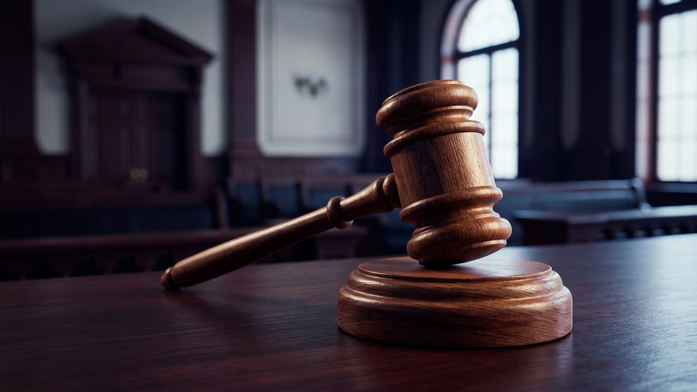

# 조희대 대법원장, 6일 국감 증인 불출석…'대법관 재제청' 공방 예고

게시 시각: 2026-10-05T20:10:00+09:00

## 요약

대법관 후보 재제청을 둘러싼 청와대와 대법원의 갈등이 6일 국회 법제사법위원회 대법원 국정감사의 최대 쟁점으로 떠올랐다.

## 본문

조희대 대법원장이 6일 열리는 국회 법제사법위원회의 대법원 국정감사에 증인으로 출석하지 않는다. 조 대법원장은 지난 2일 "증인으로 출석해 답변하기 어렵다"는 취지의 불출석 의견서를 국회에 냈다.

이번 국감의 핵심 쟁점은 대법관 후보 재제청 문제다. 조 대법원장은 8월 손봉기 부장판사를 대법관 후보로 제청했지만, 청와대는 '서면 제청'을 문제 삼아 재제청을 요구했다. 조 대법원장은 9월 22일 "재제청을 정당화할 구체적 헌법적 근거를 찾을 수 없다"며 이를 거부했다.

여권은 대법관 공석이 길어지면서 국민의 신속한 재판을 받을 권리가 침해되고 있다고 주장한다. 반면 국민의힘은 청와대의 재제청 요구가 대법원장의 헌법상 제청권과 사법부 독립을 침해한다고 맞서고 있다.

관례상 대법원장은 국감에서 인사말만 하고 자리를 뜨며, 1988년 국정감사 부활 이후 대법원장이 의원 질의에 직접 답변한 전례는 없다. 이에 따라 질의 답변은 법원행정처장이 맡을 것으로 보인다. 법사위는 8일 법무부 국정감사를 이어간다.

## 출처

- [파이낸셜뉴스](https://www.fnnews.com/news/202610051901088282)
- [머니투데이](https://www.mt.co.kr/society/2026/10/05/2026100511113181978)

[공개 기사](https://vobtv.kr/article.html?id=d-20261005-1)
