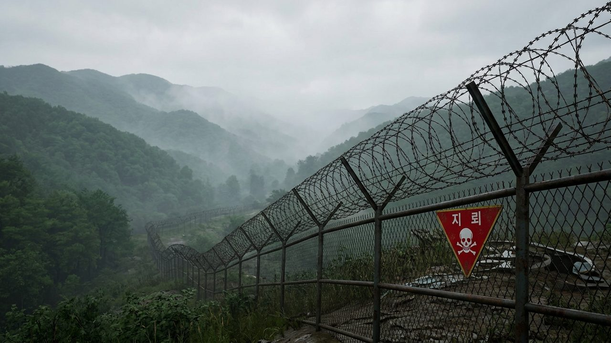

# 군, DMZ 북한 지뢰지대 제거…"북한 사과하고 지뢰 즉시 철거하라"

게시 시각: 2026-10-05T19:40:00+09:00

## 요약

지난달 21일 서부전선 DMZ 폭발 사고의 원인이 군사분계선 남쪽에 묻힌 북한군 지뢰로 최종 확인되자, 군이 5일 해당 지뢰지대를 제거했다.

## 본문

우리 군이 5일 낮 12시 51분쯤 서부전선 비무장지대(DMZ)의 군사분계선(MDL) 이남 지역에서 북한군 지뢰지대를 제거했다. 지난 9월 21일 발생한 DMZ 폭발 사고 이후 군이 취한 첫 실질적 대북 조치다.

이 사고로 장병 18명이 다쳤고, 이 가운데 2명은 중상, 1명은 중등도 부상으로 입원 치료를 받았다. 유엔군사령부가 참여한 조사단은 9월 26일부터 29일까지 현장 조사를 벌였고, 국립과학수사연구원은 장병들의 장구류와 수술 파편에서 북한제 플라스틱 대인지뢰와 같은 TNT와 멜라민 수지 성분을 확인했다.

권대원 합참 차장은 폭발 지점 3곳이 MDL에서 남쪽으로 약 10m 떨어져 있고, 매설 깊이(3~10㎝)와 배치 형태로 볼 때 지뢰가 홍수로 떠내려온 것이 아니라 의도적으로 묻힌 것으로 판단된다고 밝혔다.

군은 북한에 사과와 지뢰 즉시 철거를 요구하면서, 북한이 스스로 제거하지 않으면 제거 작전을 계속하겠다고 경고했다. 군은 대북 무력 시위와 한미연합훈련 공개 진행, 대북 사이버 독자 제재 등 추가 대응도 검토하고 있다. 대북 확성기 재설치는 당장 고려하는 카드는 아닌 것으로 알려졌다.

## 출처

- [경향신문](https://www.khan.co.kr/article/202610051616001/amp)
- [뉴데일리](https://www.newdaily.co.kr/site/data/html/2026/10/05/2026100500066.html)
- [SBS 뉴스](https://news.sbs.co.kr/news/endPage.do?news_id=N1008783619)

[공개 기사](https://vobtv.kr/article.html?id=d-20261005-2)
