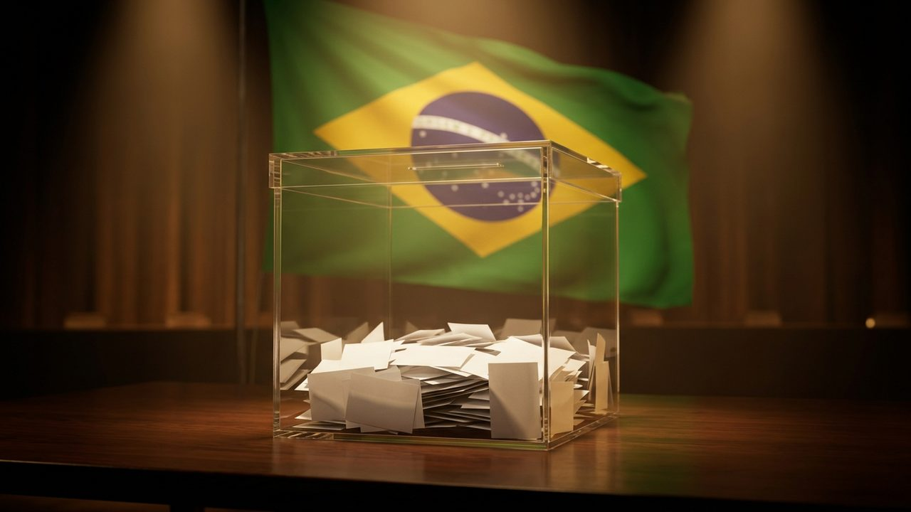

# 브라질 대선 1차 투표 '이변'…플라비우 보우소나루 47.05%로 룰라 앞서

게시 시각: 2026-10-05T17:20:00+09:00

## 요약

4일 치러진 브라질 대선 1차 투표에서 우파 자유당의 플라비우 보우소나루가 현직 룰라 대통령을 앞섰다. 두 후보는 25일 결선투표에서 다시 맞붙는다.

## 본문

4일(현지시간) 치러진 브라질 대통령 선거 1차 투표에서 자유당(PL)의 플라비우 보우소나루 후보가 47.05%를 얻어 1위에 올랐다. 4선에 도전한 루이스 이나시우 룰라 다 시우바 대통령은 45.14%에 그쳤다. 플라비우 후보는 자이르 보우소나루 전 대통령의 아들이다.

어느 후보도 과반을 얻지 못해 두 사람은 25일 결선투표에서 승부를 가린다. 선거 전 여론조사는 룰라 대통령이 1~3%포인트 앞설 것으로 내다봤지만 결과는 반대로 나왔다.

'브라질의 트럼프'로 불리는 보우소나루 후보는 "브라질은 노동자당 시대의 종식과 변화를 원한다"고 말했다. 금융시장은 재정적자와 공공부채 문제 해결에 더 적합하다는 기대 속에 보우소나루 후보의 선전을 긍정적으로 받아들였다.

전문가들은 이번 결과가 중남미 전반의 우파 바람을 키울 수 있다고 분석하는 한편, 1차 득표에는 룰라 정부에 대한 반감이 상당 부분 반영됐다는 시각도 내놓고 있다.

## 출처

- [머니투데이](https://www.mt.co.kr/world/2026/10/05/2026100511422568923)
- [아시아경제](https://view.asiae.co.kr/article/2026100511255995948)

[공개 기사](https://vobtv.kr/article.html?id=d-20261005-4)
