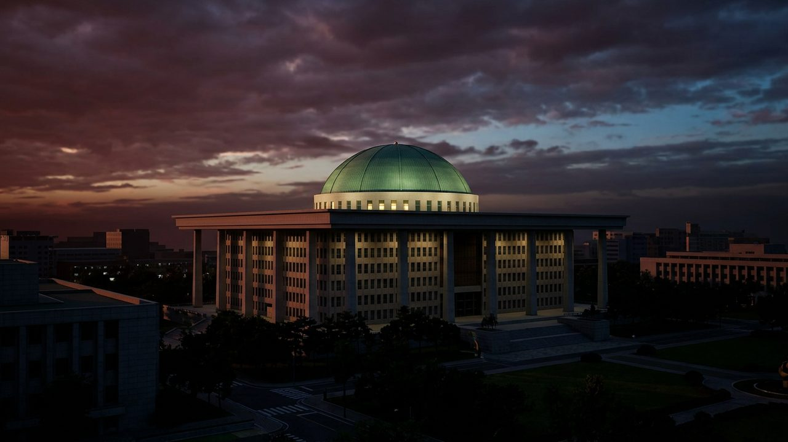

# 2026년 국정감사 6일 개막…인사·대북안보·경제통상 곳곳 격돌 예고

게시 시각: 2026-10-05T20:30:00+09:00

## 요약

이재명 정부 2년 차 국정감사가 6일부터 27일까지 열린다. 국민의힘은 인사 책임을, 더불어민주당은 민생·정책 점검을 앞세운다.

## 본문

국회 국정감사가 6일 막을 올려 27일까지 이어진다. 이재명 정부 2년 차에 열리는 이번 국감은 인사 문제와 경제·통상, 대북 안보, 형사사법체계 개편이 주요 쟁점으로 꼽힌다.

운영위원회에서는 김현지 청와대 제1부속실장의 출석 여부와 2기 개각 인사가 쟁점이다. 정점식 국민의힘 원내대표는 인사를 둘러싼 국정개입 의혹 규명을 국감 최우선 과제로 내세웠다. 정무위원회는 단일종목 레버리지 ETF 도입 경위와 금융권 해킹 사태를, 국방위원회는 DMZ 북한 지뢰 폭발 사고 대응과 북한군 포로 송환 문제를 다룬다.

경제 분야에서는 3500억 달러 규모 대미 투자와 알래스카 액화천연가스(LNG) 사업, 호남 반도체 메가클러스터 조성이 검증대에 오른다. 문화체육관광위원회에서는 영화 '암살자(들)'의 역사 왜곡 논란도 거론될 전망이다.

개막 전부터 기싸움도 거세다. 조희대 대법원장이 불출석을 통보하자 서영교 법제사법위원장은 동행명령장 발부 가능성을 내비쳤고, 국민의힘은 "민주당 입맛대로 증인을 골라 세운다"고 반발했다. 민주당은 야당 공세를 정쟁으로 규정하고 민생·정책 국감으로 맞선다는 방침이다.

## 출처

- [세계일보](https://www.segye.com/newsView/20261005509021)
- [서울신문](https://www.seoul.co.kr/news/politics/2026/10/05/20261005006001)
- [안전신문](https://www.safetynews.co.kr/news/articleView.html?idxno=250840)

[공개 기사](https://vobtv.kr/article.html?id=d-20261005-6)
