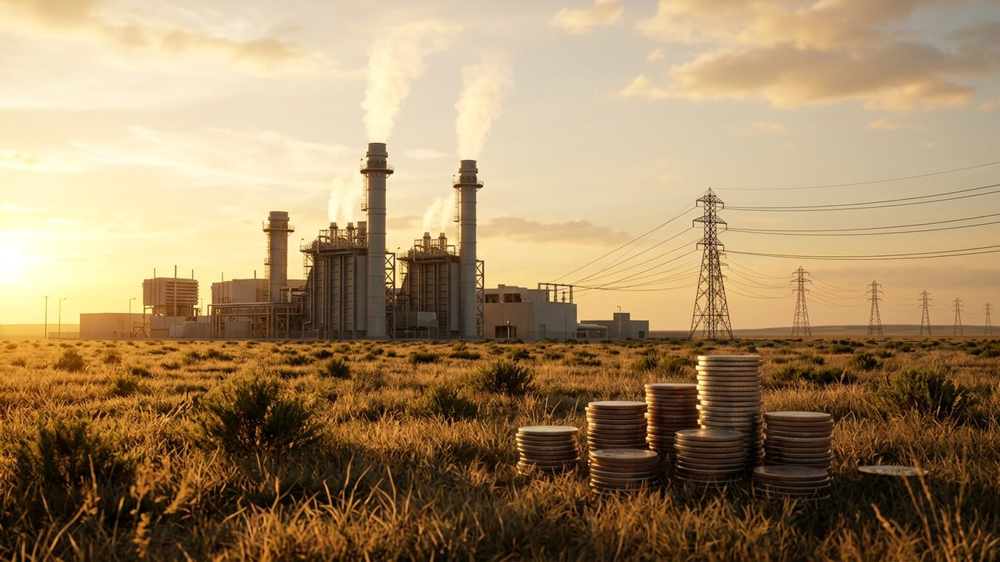

# 경제 국감 6일 시작…대미투자 1호 사업·63조 초과세수 검증대

게시 시각: 2026-10-05T20:20:00+09:00

## 요약

국회 재정경제기획위원회가 6일 기획재정부부터 국감에 나선다. 3500억 달러 대미투자 첫 사업과 63조원 넘는 세수 추계 오차가 핵심 쟁점이다.

## 본문

국회 재정경제기획위원회가 6일 기획재정부를 시작으로 경제 분야 국정감사에 들어간다. 8일 기획예산처, 12일 한국은행, 13일 국세청, 15일 관세청 감사가 이어진다.

가장 주목받는 것은 3500억 달러 규모 대미투자의 1호 사업으로 정해진 미국 텍사스주 가스복합화력발전소다. 총사업비는 223억 달러로, 정부는 20년간 432억~454억 달러를 회수할 수 있다고 본다. 다만 사업의 전제인 장기 전력구매계약이 아직 맺어지지 않아 상업성과 회수 가능성을 놓고 공방이 예상된다.

세수 추계 오차도 쟁점이다. 올해 국세수입은 478조6000억원으로 추가경정예산 때 잡은 415조4000억원보다 63조2000억원 많을 것으로 추산됐다. 2023~2024년 대규모 세수 결손에 이어 다시 큰 오차가 난 셈이다.

부동산 세제 개편도 다뤄진다. 실거주 1세대 1주택자 종합부동산세 기본공제를 12억원에서 14억원으로 높이는 방안을 놓고 형평성 논란이 예상된다. 서울 아파트값은 86주 연속 올라 문재인 정부 때의 최장 기록(85주)을 넘어섰다.

## 출처

- [머니투데이](https://mt.co.kr/economy/2026/10/05/2026100511212275990)
- [파이낸셜뉴스](https://fnnews.com/news/202610051446488009)

[공개 기사](https://vobtv.kr/article.html?id=d-20261005-8)
