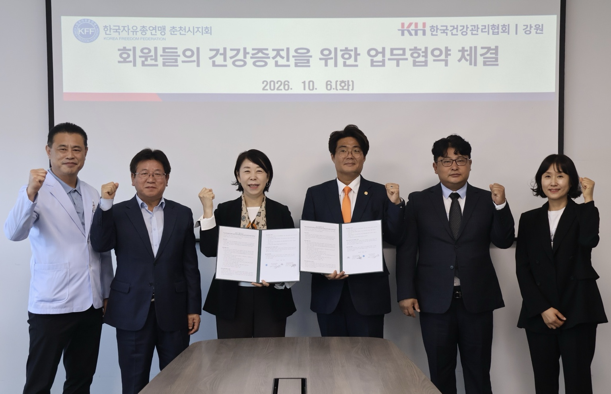

# 한국자유총연맹 춘천시지회·한국건강관리협회 강원지부, 건강증진 업무협약 체결

게시 시각: 2026-10-08T14:42:00+09:00

기자: 성현수 기자

## 요약

한국자유총연맹 춘천시지회와 한국건강관리협회 강원특별자치도지부가 회원들의 건강증진과 질병 예방을 위해 손을 맞잡았다.

양 기관 관계자들이 지난 6일 건강증진 업무협약을 체결한 뒤 기념촬영을 하고 있다. 사진 제공=한국자유총연맹 춘천시지회

## 본문

[VoB TV | 춘천=성현수 기자]

한국자유총연맹 춘천시지회와 한국건강관리협회 강원특별자치도지부가 회원들의 건강증진과 질병 예방을 위해 손을 맞잡았다.

양 기관은 지난 6일 회원 건강증진을 위한 업무협약(MOU)을 체결하고 상호 협력체계를 구축했다.

이번 협약은 한국자유총연맹 춘천시지회 회원들의 건강검진 참여 기회를 확대하고, 질환의 조기 발견과 예방을 통해 건강한 일상생활을 지원하기 위해 마련됐다.

양 기관은 정기적인 건강검진의 중요성을 알리고 예방 중심의 건강관리 체계를 강화하는 데 협력할 것으로 기대된다.

한국자유총연맹 춘천시지회는 지역사회 발전을 위한 다양한 활동을 이어가고 있으며, 이번 협약을 통해 회원들의 건강과 복지 증진에도 힘을 보태게 됐다.

양 기관의 이번 협력이 회원들의 건강관리 수준을 높이고 지역사회 건강증진에 기여하는 계기가 될 것으로 기대된다.

성현수 기자 | VoB TV

## 출처

[공개 기사](https://vobtv.kr/article.html?id=local-20261008-health-mou)
