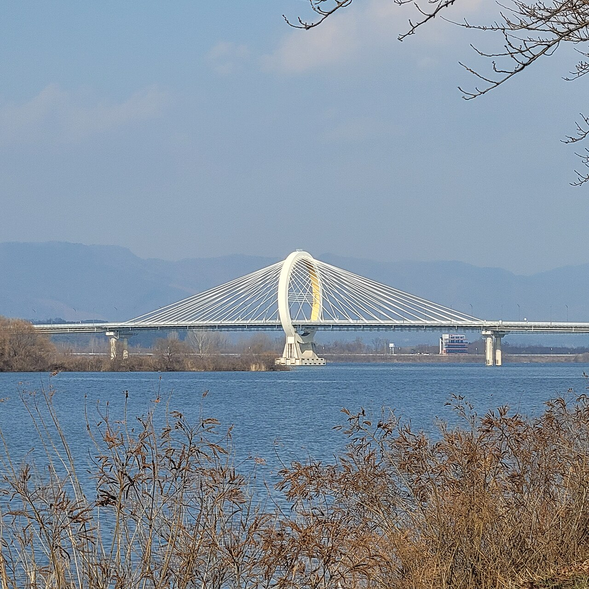

# 춘천 공지천호수축제 마무리…시 집계 13만2000여 명 방문

게시 시각: 2026-10-11T23:35:00+09:00

기자: 성현수 기자

## 요약

10월 9~11일 열린 춘천 공지천호수축제에 13만2000여 명이 방문했다고 춘천시와 춘천문화재단이 밝혔다. 커피·재즈·정원 프로그램을 같은 공간에서 연결한 축제였다.

자료사진: 2023년 12월 26일 공지천유원지에서 바라본 춘천대교. 촬영=YellowTurtle9 / Wikimedia Commons, CC BY 4.0 (https://creativecommons.org/licenses/by/4.0/). 원본의 공개 1280px 버전 사용. 2026년 축제 현장 사진이 아닙니다.

## 본문

[VoB TV | 춘천=성현수 기자]

춘천 공지천 수변에서 사흘간 이어진 ‘2026 춘천 공지천호수축제’가 11일 마무리됐다. 춘천시와 춘천문화재단이 발표한 방문 규모는 13만2000여 명이다. 이 수치는 커피 로드샵과 음식·판매 부스 이용 등을 바탕으로 시가 집계한 것으로, 개별 입장권을 센 인원과는 구분된다.

이번 행사는 공지천재즈페스타, 춘천커피페스타, 춘천호수정원페스타를 수변 산책로에서 연결했다. 시민과 관광객이 한 공간을 걸으며 커피를 맛보고, 정원을 둘러보고, 공연을 관람하도록 구성한 것이 특징이다.

재즈 공연 뒤에는 지역 업소에서 야간 공연이 이어졌다. 정원 프로그램에는 시민과 학생이 만든 정원 10곳이 참여했으며, 정원 설명과 만들기 체험도 진행됐다. 공연장뿐 아니라 지역 가게와 시민 활동을 축제 동선에 함께 담았다.

춘천시는 시민 반응과 현장 의견을 반영해 공지천의 매력을 살리는 축제를 이어가겠다는 입장을 밝혔다. 본문은 춘천시 행사 안내와 11일 발표 내용을 전한 보도를 대조해 새로 작성했다. 아래 사진은 2023년에 촬영한 공지천 주변 자료사진이며 이번 축제 현장 사진이 아니다.

## 출처

- [춘천시 행사 안내](https://www.chuncheon.go.kr/happiness/festival-news/?bbsId=BBSMSTR_000000000295&flag=view&nttId=465037)
- [아시아경제(2026-10-11)](https://www.asiae.co.kr/article/2026101114510551202)
- [사진: YellowTurtle9 / Wikimedia Commons](https://commons.wikimedia.org/wiki/File:20231226_공지천유원지에서_바라본_춘천대교_전경.jpg)

[공개 기사](https://vobtv.kr/article.html?id=local-20261011-gongjicheon-festival)
