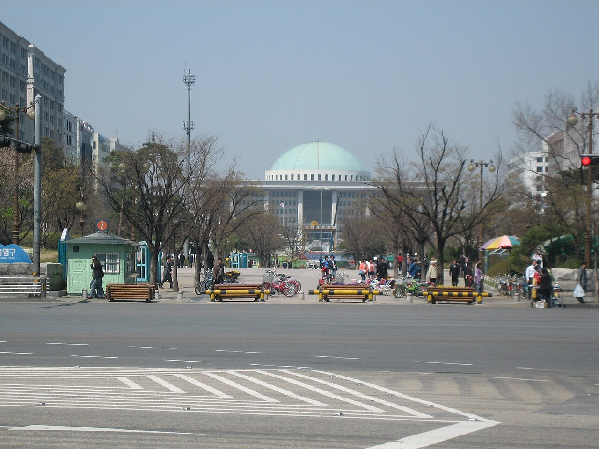

# 국민의힘, 국감 2주 차 앞두고 정책 책임 공세…장관·금융위원장 사퇴 요구

게시 시각: 2026-10-11T23:34:00+09:00

기자: 성현수 기자

## 요약

국민의힘이 11일 기자간담회에서 단일종목 레버리지 ETF, 농지 전수조사, 중대범죄수사청 출범을 비판하며 관계 기관 책임자들의 사퇴를 요구했다.

자료사진: 서울 여의도 국회의사당 외관, 2007년 4월 9일 촬영. 촬영=Alain Seguin / Wikimedia Commons, CC BY-SA 3.0 (https://creativecommons.org/licenses/by-sa/3.0/). 공개 1280px 버전 사용, 사진에 동일 라이선스 적용. 2026년 간담회 현장 사진이 아닙니다.

## 본문

[VoB TV | 춘천=성현수 기자]

국민의힘이 국정감사 첫 주에 제기한 정책 쟁점을 바탕으로 정부의 책임을 묻는 공세를 이어갔다. 정점식 원내대표는 11일 오전 국정감사 현안 기자간담회에서 금융·농지·치안 분야의 정책 집행을 비판했다.

국민의힘 공보실이 공개한 간담회 자료에 따르면, 정 원내대표는 단일종목 레버리지 상장지수펀드(ETF)의 도입 과정, 농지 전수조사와 후속 보완 조치, 중대범죄수사청 출범 준비를 주요 문제로 제시했다.

정 원내대표는 송미령 농림축산식품부 장관, 윤호중 행정안전부 장관, 이억원 금융위원장이 각각 해당 정책에 책임을 지고 사퇴해야 한다고 주장했다. 농지 조사 보완 대책이 국감 뒤에 나온 경위와 중수청의 인력·시설 준비 상황에 대해서도 설명을 요구했다.

이번 발언은 국민의힘의 정치적 평가와 책임 추궁이다. 정책 손실 규모나 행정상 위법 여부가 독립적인 조사로 확정됐다는 의미는 아니다. 정부 정책의 실제 집행 결과와 담당 기관의 해명을 함께 확인해야 사퇴 요구의 근거를 판단할 수 있다.

본 기사는 10월 11일 국민의힘 기자간담회 공개 자료를 바탕으로 작성했다. 국회 사진은 2007년에 촬영한 외관 자료사진이며 이날 간담회 현장 사진이 아니다.

## 출처

- [국민의힘 공보실(2026-10-11 기자간담회)](https://www.peoplepowerparty.kr/news/comment_view_all/116227?gubun_list=all&page=1)
- [사진: Alain Seguin / Wikimedia Commons](https://commons.wikimedia.org/wiki/File:Korea-Seoul-Yeouido-National_Assembly_Building-02.jpg)

[공개 기사](https://vobtv.kr/article.html?id=politics-20261011-audit-accountability)
