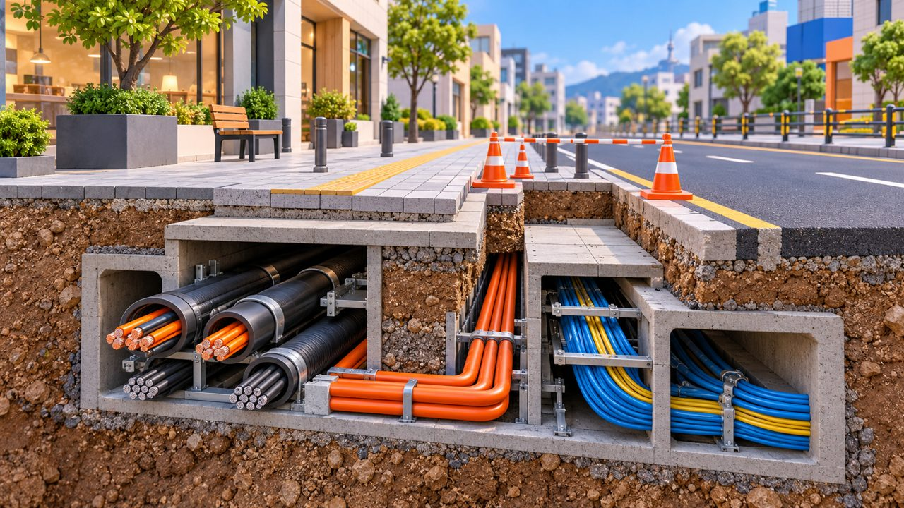

# 춘천 후평동 전선 지중화 19일 시작…공단오거리~성심병원 약 500m

게시 시각: 2026-10-13T08:53:29+09:00

기자: 성현수 기자

## 요약

춘천시가 10월 19일부터 후평동 공단오거리~한림대학교춘천성심병원 앞 약 500m 구간에서 전선 지중화 공사를 추진한다. 올해는 굴착과 임시 포장을 진행하며, 작업 구간은 부분 통제된다.

AI 생성 3D 삽화 · VoB TV. 전선 지중화의 개념을 설명하는 단면 모형으로, 실제 후평동 현장이나 설계도를 재현한 사진이 아닙니다.

## 본문

[VoB TV | 춘천=성현수 기자]

춘천 후평동 공단오거리에서 한림대학교춘천성심병원 앞으로 이어지는 약 500m 구간의 전선·통신선 지중화 공사가 10월 19일 시작될 예정이다. 춘천시는 12일 공개 자료에서 한국전력공사와 KT·SK·LG U+ 등 통신 3사가 함께 사업을 추진한다고 밝혔다.

이번 공사의 대상은 후평현대1차·세경3차 아파트 일원이다. 10월 19일부터 12월 31일까지 도로를 굴착해 지중관로와 맨홀을 설치하고 임시 포장을 진행한다. 건물별 전기·통신선 연결을 위한 관로도 함께 마련한다.

시가 제시한 후속 일정은 2027년 4월 공정 재개와 도로 본포장, 같은 해 연말 사업 마무리다. 현장 여건에 따라 일정은 달라질 수 있어 올해 말 임시 포장을 전체 공사 완료로 받아들여서는 안 된다.

공사 중에는 작업 위치에 따라 도로와 보행로가 부분 통제된다. 구간 안에 주차한 차량은 이동 협조가 필요하며, 시민은 현장 안내에 따라 통행해야 한다. 춘천시는 전주와 사용하지 않는 선로를 정리해 보행 공간과 도시 경관을 개선한다는 계획이다.

공사 관련 문의는 춘천시 도로과 도로관리팀(033-250-3164)으로 할 수 있다.

## 출처

- [춘천시 도로과 보도자료(2026-10-12)](https://www.chuncheon.go.kr/mayor/newsroom/press-release/?bbsId=BBSMSTR_000000000335&flag=view&nttId=530435)

[공개 기사](https://vobtv.kr/article.html?id=local-20261013-hupyeong-underground)
