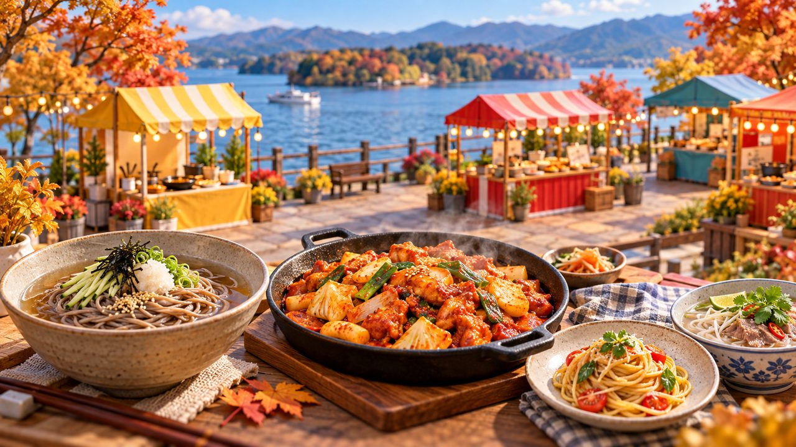

# 춘천막국수닭갈비축제 오늘 시작…국제관서 세계음식 사전 신청 시식

게시 시각: 2026-10-14T08:50:27+09:00

기자: 성현수 기자

## 요약

10월 14~18일 춘천막국수닭갈비축제 국제관에서 세계음식 시식회와 문화체험이 열린다. 무료 시식은 사전 신청 방식으로 운영되며, 가족 쿠킹클래스도 마련된다.

AI 생성 3D 삽화 · VoB TV. 지역 먹거리와 국제 음식문화 교류를 표현한 설명용 이미지이며, 실제 축제 현장이나 공식 메뉴 사진이 아닙니다.

## 본문

[VoB TV | 춘천=성현수 기자]

춘천막국수닭갈비축제가 10월 14일부터 18일까지 열린다. 춘천시가 13일 발표한 국제관 운영 계획에 따르면 공지천 산책로 행사장에서는 지역 대표 먹거리와 함께 해외 여러 도시의 음식과 문화를 만날 수 있다.

올해 국제관은 세계음식 시식과 특산품 판매, 국제개발협력 홍보, 전통놀이 체험 등 16개 부스로 구성된다. 세계음식 시식회에는 6개국 7개 지역이 참여해 닷새 동안 11가지 요리를 선보일 예정이다.

무료 시식은 현장에서 누구나 즉시 받는 방식이 아니라 사전 신청을 거쳐 참여하는 프로그램이다. 시는 점심·저녁 시간대에 하루 최대 6차례 운영하고, 전체 기간 약 4500명에게 시식 기회를 제공할 계획이라고 밝혔다. 신청 안내는 국제관 홈페이지(ccglobaltaste.kr)의 ‘세계미식 시식회’에서 확인할 수 있다.

가족 쿠킹클래스는 16일 이탈리아 생면파스타 만들기와 17일 중국 셰프의 성게알 요리 체험으로 마련된다. 회당 10가족, 총 20가족을 대상으로 하며 이 프로그램도 사전 신청이 필요하다.

국제관에서는 케냐·에티오피아 커피문화와 세계 어린이 문화체험도 소개한다. 방문 전 공식 안내에서 회차별 시간과 신청 가능 여부를 확인하는 것이 좋다. 본문은 발표된 운영 계획을 정리한 것으로 실제 방문객 수나 행사 성과를 집계한 기사는 아니다.

## 출처

- [춘천시 국제협력관 보도자료(2026-10-13)](https://www.chuncheon.go.kr/mayor/newsroom/press-release/?bbsId=BBSMSTR_000000000335&flag=view&nttId=530494)

[공개 기사](https://vobtv.kr/article.html?id=culture-20261014-global-taste)
