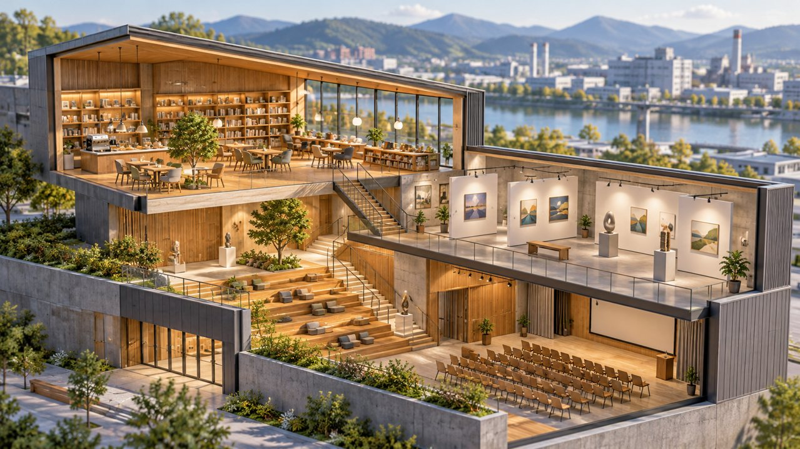

# 후평산단 ‘공간 후’ 11월 2일 개관 예정…책·전시·교육 한곳에

게시 시각: 2026-10-16T23:55:12.238Z

기자: 성현수 기자

## 요약

춘천 후평산단 복합문화센터가 11월 2일 개관식을 앞두고 시설 정비를 진행 중이다. 북카페형 쉼터와 전시·공연·교육 공간을 근로자와 시민에게 제공할 계획이다.

AI 생성 3D 삽화 · VoB TV. 복합문화공간을 설명하는 개념 모형으로 실제 공간 후의 내부나 외관을 재현한 사진이 아닙니다.

## 본문

[VoB TV | 춘천=성현수 기자]

춘천 후평 일반산업단지에 조성된 복합문화센터 ‘공간 WHO(공간 후)’가 다음 달 문을 열 예정이다. 춘천시는 15일 발표한 자료에서 11월 2일 오전 10시 개관식을 열고 운영을 시작한다고 밝혔다.

위치는 후석로440번길 39다. 총사업비 112억원을 들여 연면적 1,811㎡, 지상 3층 규모로 조성했으며, 개관을 앞두고 시설 보완과 정비를 진행하고 있다.

내부에는 산단 역사를 소개하는 전시 공간과 도서 2,500권을 갖춘 북카페형 쉼터, 디자인 관련 전시·자료 공간이 마련됐다. 공연과 강연을 위한 다목적홀, 문화교실도 함께 구성했다.

운영을 맡는 시립도서관은 근로자 대상 교양강좌와 책꾸러미 순회대출, 시민 대상 평생교육·전시·공연 등을 추진할 예정이다. 개관 기획전으로는 ‘뒤뜰 작은 미술장터’를 준비한다.

현재는 개관 전 준비 단계다. 방문이나 강좌 참여를 계획한다면 시립도서관의 후속 운영 안내를 확인할 필요가 있다.

## 출처

- [춘천시 시립도서관 보도자료(2026-10-15)](https://www.chuncheon.go.kr/mayor/newsroom/press-release/?bbsId=BBSMSTR_000000000335&flag=view&nttId=530622)

[공개 기사](https://vobtv.kr/article.html?id=local-20261017-hupyeong-culture)
