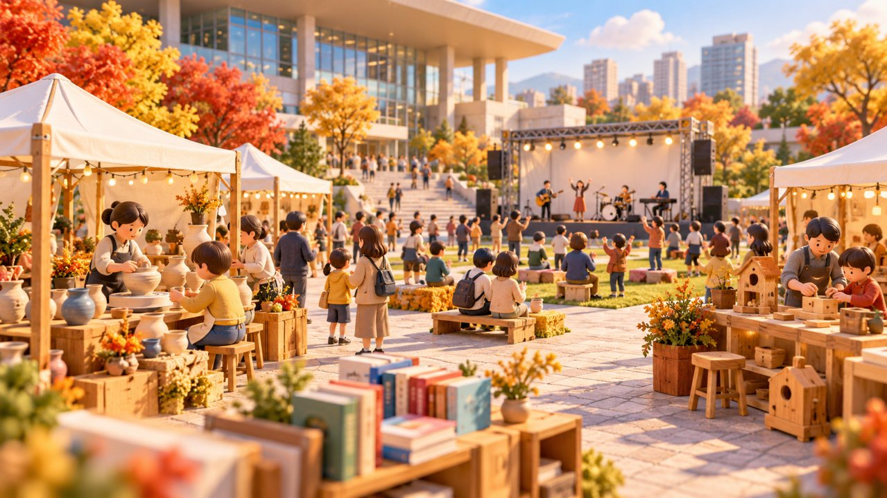

# 춘천 평생학습축제 23~24일 시청서…무료 체험·공연 일정 공개

기자: 성현수 기자

게시 시각: 2026-10-18T00:02:01.430Z

## 요약

제6회 춘천시 평생학습축제가 10월 23~24일 시청 광장과 1층 로비에서 열린다. 시민 누구나 무료로 참여할 수 있으며, 체험·홍보 부스와 공연, 작품전시 등을 마련한다.

AI 생성 3D 삽화 · VoB TV. 평생학습 체험 행사를 표현한 설명용 모형이며 실제 축제 현장이나 출연자 사진이 아닙니다.

## 본문

[VoB TV | 춘천=성현수 기자]

다음 주 춘천시청에서 평생학습 체험과 공연을 함께 즐길 수 있다. 시 평생학습관은 16일 제6회 춘천시 평생학습축제 안내문과 리플렛을 공개했다.

행사는 10월 23일과 24일 시청 광장·1층 로비에서 열린다. 공식 리플렛은 시민 누구나 무료로 이용할 수 있다고 안내하고 있다. 체험·홍보 부스는 23일 오전 11시~오후 5시, 24일 오전 10시 30분~오후 5시로 표시돼 있다.

부스에서는 목공예, 가죽공예, 종이접기, 그림, 드론 조종 등 다양한 학습 분야를 접할 수 있다. 개막식은 23일 오후 2시이며, 같은 날 오후 3시에는 ‘못난이 삼형제’ 토크콘서트가 예정돼 있다.

24일 오전 11시에는 김수찬 토크콘서트, 오후 1시~3시에는 동아리 경연대회가 편성됐다. 시민 재능나눔공연도 이틀에 걸쳐 진행한다.

작품전시는 축제 종료 뒤에도 29일까지 시청 1층 로비에서 이어진다. 리플렛은 행사장 상황에 따라 부스 위치와 프로그램 내용·일정이 바뀔 수 있고 이벤트는 준비 물품 소진 시 조기 종료될 수 있다고 안내한다. 방문 전 공식 안내를 다시 확인하는 것이 좋다.

## 출처

- [춘천시평생학습관 축제 안내·공식 리플렛(2026-10-16)](https://www.chuncheon.go.kr/cityhall/administrative-info/notice-info/municipal-news/?bbsId=BBSMSTR_000000000151&flag=view&nttId=530680)
- [행사 일정·무료 체험 안내 리플렛](https://www.chuncheon.go.kr/_cmm/fms/FileDown.do?atchFileId=FILE_000000000123119&fileSn=1&bbsId=BBSMSTR_000000000151&nttId=530680)

[공개 기사](https://vobtv.kr/article.html?id=life-20261018-learning-festival)
