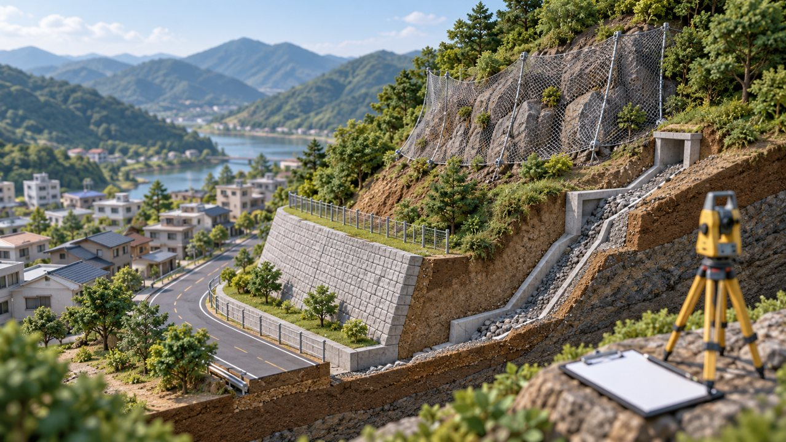

# 춘천 급경사지 48곳 점검 결과 공개…일부 구간 11월 정비 예정

기자: 성현수 기자

게시 시각: 2026-10-18T00:02:03.429Z

## 요약

춘천시가 16일 공개한 급경사지 점검 결과에 낙석·토사 유입과 보수 계획이 담겼다. 9월 점검 자료로, 일부 구간은 조치 완료, 나머지 여러 구간은 11월 작업 예정으로 기재됐다.

AI 생성 3D 삽화 · VoB TV. 급경사지 점검을 설명하는 개념 모형이며 실제 점검 구간이나 재해 현장 사진이 아닙니다.

## 본문

[VoB TV | 춘천=성현수 기자]

춘천시가 16일 시청 홈페이지에 ‘2026년 우기 대비 급경사지 안전점검 결과’를 공개했다. 첨부 자료에는 도로 주변 인공 비탈면 48곳의 위치, 기존 등급, 점검일자, 확인 사항과 조치 계획이 담겼다.

공개표의 점검일은 9월이다. 따라서 이번 소식은 10월에 새 재해가 발생했다는 발표가 아니라, 앞서 실시한 점검 결과와 후속 조치 계획의 공개다.

온의동 산17 구간에는 토사 보도부 유입, 송암동 산72-1 구간에도 토사 보도부 유입이 기재됐다. 두 구간 모두 정비 작업은 11월 예정으로 표시돼 있다. 남면 발산리 산105-3 구간은 낙석에 대한 보수작업이 11월 예정으로 적혔다.

북산면 물로리·조교리 등의 일부 구간은 조치 완료로 기재됐다. 다만 자료에 적힌 기존 등급을 새로 판정된 등급으로 해석하거나, 예정된 작업이 이미 끝난 것으로 받아들여서는 안 된다.

거주지나 이동 경로 주변 구간의 상세 내용은 시청 공지에 첨부된 표에서 확인할 수 있다. 공개 자료의 작업 예정 시점과 실제 현장 조치 상황은 구분해 살펴볼 필요가 있다.

## 출처

- [춘천시 급경사지 안전점검 결과 공개(2026-10-16)](https://www.chuncheon.go.kr/cityhall/administrative-info/notice-info/municipal-news/?bbsId=BBSMSTR_000000000151&flag=view&nttId=530673)
- [2026년 우기 대비 급경사지 안전점검 결과 PDF](https://www.chuncheon.go.kr/_cmm/fms/FileDown.do?atchFileId=FILE_000000000123112&fileSn=0&bbsId=BBSMSTR_000000000151&nttId=530673)

[공개 기사](https://vobtv.kr/article.html?id=local-20261018-slope-inspection)
